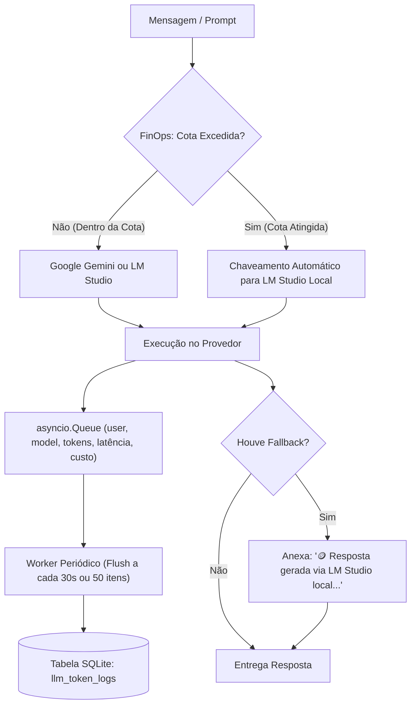

# Módulo 18: FinOps, Telemetria de Tokens & Observabilidade LLM

O módulo de **FinOps, Telemetria de Tokens e Observabilidade de Custos LLM** (originado na `IDEA-28` e implementado na `OS-019`) fornece ao ecossistema contabilidade em tempo real de tokens de entrada e saída, latência de inferência, custos monetários acumulados e controle defensivo de cotas diárias por usuário e por tarefas em background, com chaveamento transparente (*fallback gracioso*) para o nó LM Studio local.

---

## 1. Visão Geral e Propósito

Operando em conjunto com o Roteamento Híbrido ([`MOD-VIS-10`](file:///Users/rodrigomodel/antigravity/discord/SPECs/modulos_visiveis/10_ROTEAMENTO_HIBRIDO_E_GOOGLE_GEMINI.md)) e a Camada de Dados SQLite WAL ([`MOD-INT-01`](file:///Users/rodrigomodel/antigravity/discord/SPECs/modulos_internos/01_BANCO_DE_DADOS_SQLITE.md)), o FinOps Manager introduz uma governança financeira e de recursos que impede gastos imprevistos na nuvem, mede a economia gerada pela computação local e garante continuidade operacional sem travar o usuário.

### 1.1 Objetivos Centrais
1. **Contabilidade de Tokens com Zero Overhead:** Interceptar os metadados de `usage` do Gemini API e LM Studio no [`llm_client.py`](file:///Users/rodrigomodel/antigravity/discord/llm_client.py), enfileirando em uma fila assíncrona em memória (`asyncio.Queue`) descarregada em lote via `executemany` a cada 30 segundos no SQLite WAL.
2. **Circuit Breaker com Fallback Gracioso:** Ao atingir o teto diário de tokens de nuvem (padrão: 200.000 tokens para usuários interativos e 500.000 tokens para background), o sistema chaveia automaticamente para o modelo local gratuito no LM Studio, anexando uma nota de rodapé transparente sem interromper o diálogo.
3. **Isolamento de Background:** Tarefas automatizadas do sistema (como Resumo Matinal `MOD-VIS-08` e Pesquisa Profunda `MOD-VIS-16`) consomem uma cota dedicada de background (`user_id='SYSTEM_BACKGROUND'`), impedindo a canibalização dos limites de usuários regulares.
4. **Demonstração de ROI Local:** Cálculo em tempo real da economia financeira gerada por inferências processadas no hardware local versus seu custo hipotético em nuvem.

---

## 2. Arquitetura e Fluxo de Dados

---

## 3. Comandos de Linha de Comando (Prefixo `!`)

Os comandos são integrados ao [`discord/commands/system_commands.py`](file:///Users/rodrigomodel/antigravity/discord/commands/system_commands.py) sob a categoria **"FinOps & Custos"**:

| Comando | Descrição | Exemplo |
| :--- | :--- | :--- |
| `!finops [status]` | Exibe o painel consolidado dos últimos 30 dias (tokens, custo USD/BRL, economia local e barra de cota). | `!finops status` |
| `!finops cotas` | Mostra o consumo detalhado do usuário e do background com barras ASCII e status. | `!finops cotas` |
| `!finops modelos` | Ranking dos modelos mais utilizados por volume de tokens e custo associado. | `!finops modelos` |
| `!finops reset [user]` | *(Administrador/Arquiteto)* Reseta o contador diário do usuário indicado ou do autor. | `!finops reset 123456789` |

---

## 4. Ferramentas da IA (*Function Calling*)

Registrada em [`discord/tools/finops_tools.py`](file:///Users/rodrigomodel/antigravity/discord/tools/finops_tools.py):

* **`consultar_metricas_finops(dias: int = 30) -> dict`:**
  * Permite à LLM auditar métricas de custos e responder perguntas sobre consumo de tokens do usuário e do sistema.
  * Contrato estrito: `{"sucesso": bool, "dados": {"resumo_periodo", "cotas_usuario", "top_modelos"}, "erro": Optional[str]}`.

---

## 📋 Matriz de Rastreabilidade & Aderência (Auditada em 2026-11-14)

| Requisito Formal | Arquivo de Origem | Símbolo / Linhas | Status |
| :--- | :--- | :--- | :---: |
| **REQ-01: Gestor de FinOps e Buffer Assíncrono** | [`finops_manager.py`](file:///Users/rodrigomodel/antigravity/discord/finops_manager.py#L90-L160) | `FinOpsManager`, `registrar_uso`, `flush` | 🟢 Aderente |
| **REQ-02: Tabela de Preços e Cálculo de Economia** | [`finops_manager.py`](file:///Users/rodrigomodel/antigravity/discord/finops_manager.py#L22-L75) | `PRECOS_MODELOS_1M`, `calcular_custo_tokens`, `calcular_economia_local` | 🟢 Aderente |
| **REQ-03: Persistência SQLite WAL em Lote** | [`finops_manager.py`](file:///Users/rodrigomodel/antigravity/discord/finops_manager.py#L76-L115) | `init_finops_db`, `_persistir_lote_db` | 🟢 Aderente |
| **REQ-04: Circuit Breaker e Fallback Gracioso** | [`llm_client.py`](file:///Users/rodrigomodel/antigravity/discord/llm_client.py#L290-L360) | `gerar_resposta`, `forcou_fallback_cota` | 🟢 Aderente |
| **REQ-05: Interceptação de Uso e Latência** | [`llm_client.py`](file:///Users/rodrigomodel/antigravity/discord/llm_client.py#L183-L255) | `_executar_loop_completions` | 🟢 Aderente |
| **REQ-06: Isolamento de Contexto Origin Type** | [`context_manager.py`](file:///Users/rodrigomodel/antigravity/discord/context_manager.py#L84-L95) | `set_current_origin_type`, `get_current_origin_type` | 🟢 Aderente |
| **REQ-07: Comandos !finops (4 subcomandos)** | [`commands/system_commands.py`](file:///Users/rodrigomodel/antigravity/discord/commands/system_commands.py#L840-L950) | `cmd_finops`, `_render_ascii_bar` | 🟢 Aderente |
| **REQ-08: Tool LLM consultar_metricas_finops** | [`tools/finops_tools.py`](file:///Users/rodrigomodel/antigravity/discord/tools/finops_tools.py#L13-L45) | `tool_consultar_metricas_finops` | 🟢 Aderente |
| **REQ-09: Suíte de Testes Automatizados** | [`tests/test_finops.py`](file:///Users/rodrigomodel/antigravity/tests/test_finops.py#L21-L100) | `TestFinOpsManager` (5 testes isolados) | 🟢 Aderente |
