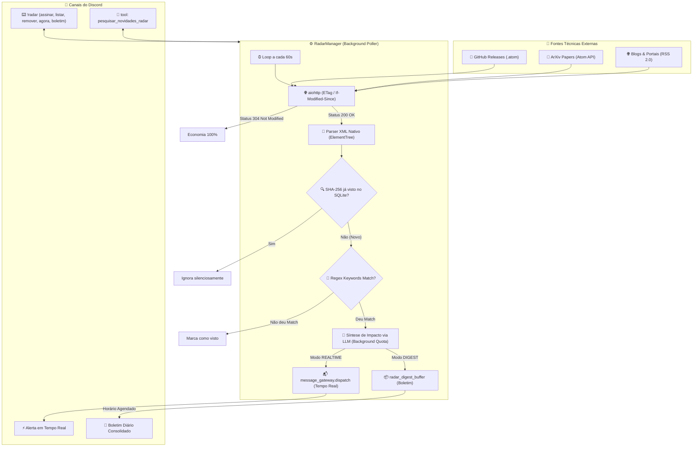

# Módulo Visível 19: Radar Autônomo de RSS, ArXiv & GitHub (IDEA-29)

## 1. Visão Geral & Proposta de Valor

O **Radar Autônomo de Feeds** transforma o bot em uma sentinela de inteligência técnica proativa. Em vez de depender de buscas manuais, o usuário e as equipes podem registrar fontes de interesse contínuo:
1. **GitHub Releases:** Monitora novos lançamentos de repositórios open-source cruciais (ex: `vllm-project/vllm`, `huggingface/transformers`) através de feeds Atom nativos (`/releases.atom`), sem necessidade de chaves de API ou consumo do rate limit REST do GitHub.
2. **ArXiv Papers:** Ingestão de artigos científicos recentes via Atom API do ArXiv (`arxiv:cs.AI`, `arxiv:cs.CL`, etc.).
3. **Feeds RSS/Atom Tradicionais:** Blogs técnicos, newsletters de engenharia e sites de tecnologia.

O sistema atua com **filtragem em duas etapas**:
- **Etapa 1 (Custo Zero):** Regex determinístico de palavras-chave no título e descrição. Se não der match, descarta silenciosamente sem invocar modelos.
- **Etapa 2 (Síntese Executiva via LLM):** Para itens aprovados, gera uma síntese de 2 a 3 bullet points focados em impacto prático, descarregando o custo na cota dedicada de background (`IDEA-28`).
- **Despacho Flexível:** Despacho instantâneo em tempo real ou consolidado em boletins diários por canal no horário configurado.

---

## 2. Diagrama de Arquitetura & Fluxo de Dados



---

## 3. Comandos & Interfaces com o Usuário

### Comando de Prefixo: `!radar`
Registrado na categoria `"Radar & Conhecimento"`, com aliases `!feed` e `!rss`.

| Subcomando | Sintaxe | Descrição |
| :--- | :--- | :--- |
| `assinar` | `!radar assinar <fonte> [--tempo-real] [--boletim HH:MM] [--filtro "regex"]` | Cadastra monitoramento de `dono/repo`, `arxiv:categoria` ou URL RSS. |
| `listar` | `!radar listar` | Lista as assinaturas ativas do usuário e seus canais de entrega. |
| `remover` | `!radar remover <id>` | Cancela o monitoramento de uma assinatura específica. |
| `agora` | `!radar agora` | Força a varredura e processamento imediato dos feeds agendados. |
| `boletim` | `!radar boletim` | Força o envio imediato das novidades acumuladas no buffer para o canal. |

### Function Calling Tool: `pesquisar_novidades_radar`
Permite à LLM consultar novidades já capturadas e arquivadas no radar:
- **Assinatura:** `pesquisar_novidades_radar(termo: Optional[str] = None, limite: int = 5) -> Dict[str, Any]`
- **Retorno:** Lista de itens capturados com fonte, título, link e data de processamento.

---

## 4. Estrutura de Tabelas no SQLite WAL

```sql
-- Assinaturas ativas de feeds
CREATE TABLE IF NOT EXISTS radar_subscriptions (
    id INTEGER PRIMARY KEY AUTOINCREMENT,
    user_id TEXT NOT NULL,
    channel_id TEXT NOT NULL,
    source_type TEXT NOT NULL,          -- 'GITHUB', 'ARXIV', 'RSS'
    source_url TEXT NOT NULL,
    keywords_regex TEXT,
    mode TEXT NOT NULL DEFAULT 'DIGEST',-- 'REALTIME' ou 'DIGEST'
    digest_time TEXT DEFAULT '18:00',
    etag TEXT,
    last_modified TEXT,
    next_run_at TIMESTAMP NOT NULL,
    ativo INTEGER NOT NULL DEFAULT 1,
    created_at TIMESTAMP DEFAULT CURRENT_TIMESTAMP,
    last_digest_date TEXT DEFAULT NULL
);

-- Itens já processados (desduplicação por SHA-256)
CREATE TABLE IF NOT EXISTS radar_seen_items (
    item_hash TEXT PRIMARY KEY,
    subscription_id INTEGER NOT NULL,
    title TEXT NOT NULL,
    link TEXT NOT NULL,
    processed_at TIMESTAMP DEFAULT CURRENT_TIMESTAMP,
    FOREIGN KEY (subscription_id) REFERENCES radar_subscriptions(id) ON DELETE CASCADE
);

-- Buffer de acumulação para boletins periódicos
CREATE TABLE IF NOT EXISTS radar_digest_buffer (
    id INTEGER PRIMARY KEY AUTOINCREMENT,
    subscription_id INTEGER NOT NULL,
    channel_id TEXT NOT NULL,
    title TEXT NOT NULL,
    link TEXT NOT NULL,
    summary TEXT NOT NULL,
    created_at TIMESTAMP DEFAULT CURRENT_TIMESTAMP
);
```

---

## 5. Rastreabilidade Reversa (Spec $\leftrightarrow$ Código)

| Componente da Spec | Arquivo de Implementação | Símbolo / Função | Linhas Aprox. |
| :--- | :--- | :--- | :--- |
| **Manager & Poller** | [`discord/radar_manager.py`](file:///Users/rodrigomodel/antigravity/discord/radar_manager.py) | `RadarManager`, `radar_manager` | L243-L640 |
| **Parser XML Nativo** | [`discord/radar_manager.py`](file:///Users/rodrigomodel/antigravity/discord/radar_manager.py) | `fazer_parse_xml_feed` | L155-L240 |
| **Normalizador de URLs** | [`discord/radar_manager.py`](file:///Users/rodrigomodel/antigravity/discord/radar_manager.py) | `normalizar_url_fonte` | L130-L153 |
| **Comando de Prefixo** | [`discord/commands/knowledge_commands.py`](file:///Users/rodrigomodel/antigravity/discord/commands/knowledge_commands.py) | `cmd_radar` | L545-L680 |
| **Tool da LLM** | [`discord/tools/research_tools.py`](file:///Users/rodrigomodel/antigravity/discord/tools/research_tools.py) | `tool_pesquisar_novidades_radar` | L100-L150 |
| **Inicialização no Gateway** | [`discord/chat_discord.py`](file:///Users/rodrigomodel/antigravity/discord/chat_discord.py) | `on_ready` | L125-L130 |
| **Testes Automatizados** | [`tests/test_radar.py`](file:///Users/rodrigomodel/antigravity/tests/test_radar.py) | `TestRadarManager` | L1-L210 |
| **Resiliência Catch-Up Offline** | [`discord/radar_manager.py`](file:///Users/rodrigomodel/antigravity/discord/radar_manager.py) | `verificar_envio_boletins` | L620-L680 |
| **Laudo de Auditoria** | [`gerencial/reviews/REV-032_auditoria_radar_autonomo_rss_feeds.md`](file:///Users/rodrigomodel/antigravity/gerencial/reviews/REV-032_auditoria_radar_autonomo_rss_feeds.md) | Laudo `/review` | L1-L45 |
