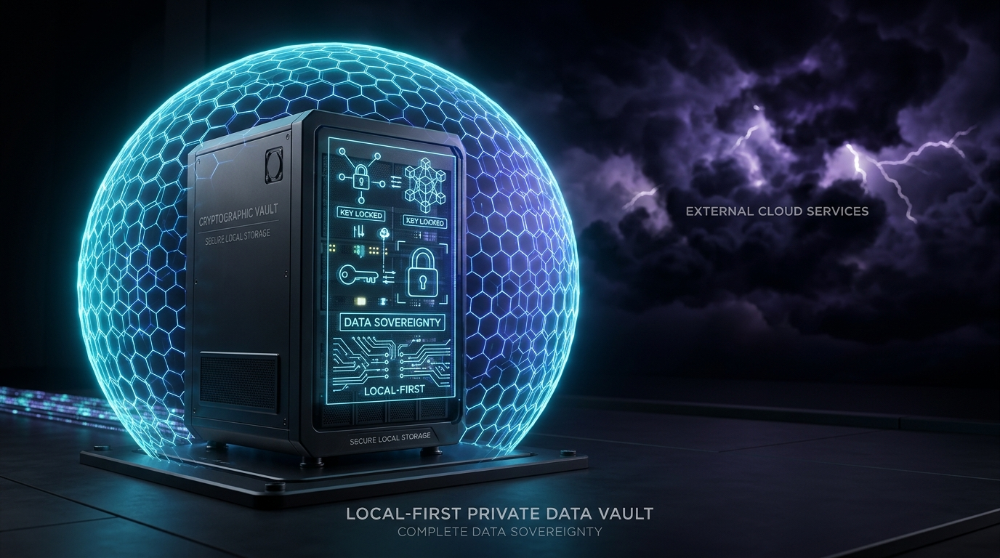
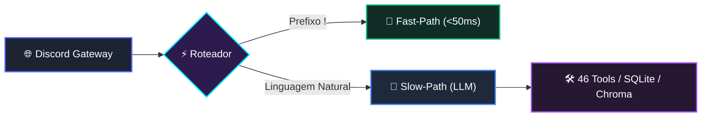
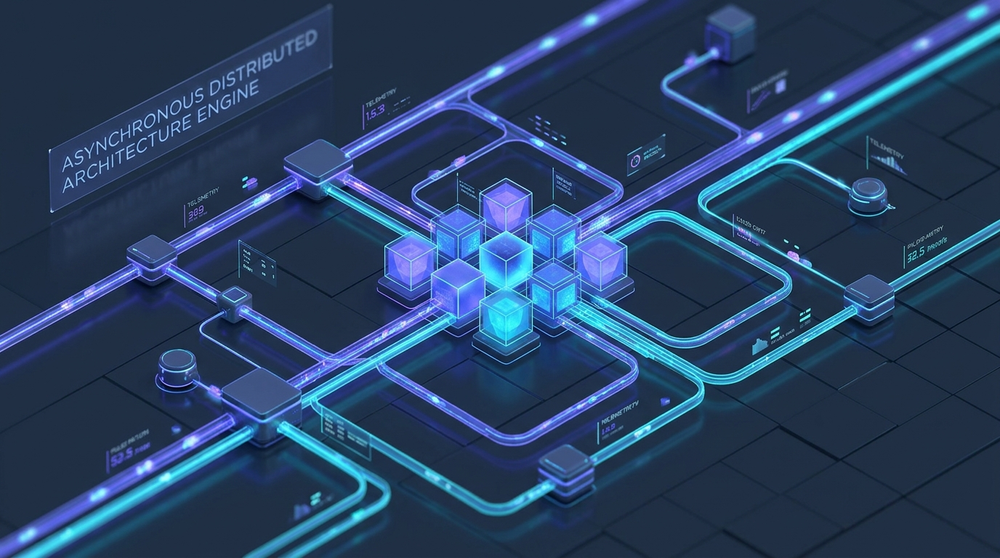
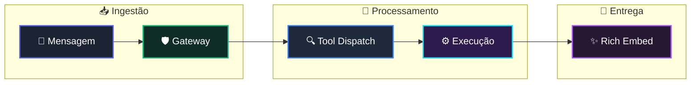

<!-- _transition: fade -->

# Assistente Autônomo Local-First no Discord
Layout: [Destaque Numérico / Stat Callout]

Plataforma inteligente orientada a eventos, combinando **automação determinística** e **IA híbrida**.

- **34** Comandos Nativos com Prefixo (`!`)
- **46** Ferramentas de *Function Calling*
- **15** Agentes no Ecossistema de Governança
- **0.3s** para Execução da Suíte (41 testes)

<!--
🎯 Ponto Focal: Apresentar o projeto como um ecossistema maduro, local-first e de altíssima performance.
🗣️ Fala Sugerida (45-50s): "Olá a todos. Apresento a estrutura geral do nosso assistente autônomo para Discord. Não se trata de um bot comum de comandos simples, mas de uma plataforma orientada a eventos que combina automação ultrarrápida com inteligência artificial híbrida. Com 34 comandos nativos, 46 ferramentas de chamada de função e um ecossistema de 15 agentes especializados, garantimos velocidade máxima e privacidade total, respaldados por 41 testes automatizados executados em apenas 0.3 segundos."
🔗 Gancho de Transição: "Mas para entender o valor dessa arquitetura, precisamos primeiro olhar para os problemas clássicos dos bots que existem no mercado."
-->

---

<!-- _transition: slide -->

# O Problema dos Bots Convencionais
Layout: [Antes vs Depois / Comparativo de Fricção]

**Bots Tradicionais na Nuvem:**
- Dependência de APIs pagas e **custo contínuo por token**
- Bloqueio da interface por I/O síncrono e latência
- Dados sensíveis centralizados em servidores externos

**Nossa Abordagem Local-First:**
- **Inferência local com custo zero** (LM Studio)
- Loop **100% assíncrono** com isolamento de contexto
- Persistência privada em **SQLite WAL** e **ChromaDB**

<!--
🎯 Ponto Focal: Evidenciar o contraste radical entre o modelo frágil/caro tradicional e a soberania do nosso sistema.
🗣️ Fala Sugerida (50s): "A maioria dos bots de IA corporativos comete três erros fundamentais: envia cada mensagem boba para APIs caras na nuvem acumulando custos, trava o loop de mensagens ao processar arquivos ou chamadas de banco, e expõe os dados dos usuários em servidores externos. Nós invertemos completamente essa lógica: adotamos um modelo local-first onde comandos rotineiros rodam com latência quase zero e sem custo de tokens, enquanto a persistência é 100% privada e local."
🔗 Gancho de Transição: "Essa separação eficiente nos leva direto ao coração da nossa arquitetura: a divisão entre Fast-Path e Slow-Path."
-->

---

<!-- _transition: zoom -->

# Arquitetura: Fast-Path vs Slow-Path
Layout: [Split 50/50: Texto + Diagrama]

Roteamento inteligente desacoplado para máxima eficiência:

- **Fast-Path (<50ms):** Comandos nativos sem overhead de IA
- **Slow-Path:** LM Studio local com failover Gemini API

<!--
🎯 Ponto Focal: Demonstrar o desacoplamento de responsabilidades e a garantia de tempos de resposta instantâneos.
🗣️ Fala Sugerida (55s): "Aqui está o núcleo arquitetural do sistema. Toda mensagem do Discord entra pelo Gateway e passa por um roteador assíncrono. Se o usuário envia um comando determinístico de agenda ou anotações, ativamos o Fast-Path: a resposta sai em menos de 50 milissegundos sem acionar inteligência artificial. Quando o usuário faz uma pergunta aberta em linguagem natural, o Slow-Path entra em ação, orquestrando modelos locais no LM Studio com transbordo automático para a API do Gemini caso o servidor local esteja offline."
🔗 Gancho de Transição: "E como mantemos esse sistema resiliente e seguro mesmo sob tráfego intenso? Através do nosso núcleo de mensageria e persistência."
-->

---

<!-- _transition: slide -->

# Núcleo de Resiliência & Persistência
Layout: [3 Colunas de Cards]

**Message Gateway**
- Fila *Leaky Bucket*
- Anti-spam por hash SHA256
- *Chunking* defensivo de 2000 chars

**SQLite Local (WAL)**
- Isolamento via *ContextVars*
- Transações ACID ultra-rápidas
- Histórico de canais e notas

**ChromaDB Vetorial**
- Embeddings semânticos locais
- RAG para documentos e PDFs
- Recuperação por similaridade

<!--
🎯 Ponto Focal: Comprovar que a infraestrutura é robusta, resiliente a rate limits e à prova de perda de dados.
🗣️ Fala Sugerida (50s): "Nossa camada de sustentação é dividida em três pilares concretos. Primeiro, o Message Gateway com algoritmo Leaky Bucket e hash SHA256 anti-spam, que impede que o bot tome ban da API do Discord e garante chunking semântico para textos longos. Segundo, o SQLite em modo WAL com ContextVars, assegurando que múltiplos canais acessem o banco concorrentemente com integridade ACID. E terceiro, o ChromaDB local, que processa faturas, PDFs e histórico de conversas via RAG sem vazar informações confidenciais."
🔗 Gancho de Transição: "Vamos agora ver como tudo isso se conecta na esteira prática durante uma demonstração de uso."
-->

---

<!-- _transition: flip -->

# Demonstração: Esteira de Execução Real
Layout: [Timeline Horizontal / Esteira]

- Ingestão assíncrona protegida contra *rate limits*
- *Tool Call* tipado com schema JSON estrito
- Renderização visual elegante em **Rich Embeds**

<!--
🎯 Ponto Focal: Conduzir a audiência pela jornada visual de uma requisição real do Discord até a resposta final.
🗣️ Fala Sugerida (50s): "Na demonstração prática, o fluxo é fluido e elegante. O usuário envia uma mensagem no Discord solicitando, por exemplo, o resumo de uma fatura ou uma busca na web. O Gateway captura o evento sem travar a thread de rede, a LLM analisa o pedido e seleciona uma das 46 ferramentas tipadas. A tool executa em thread assíncrona via asyncio.to_thread, e o resultado é devolvido ao usuário formatado em Rich Embeds coloridos e legíveis, com indicadores de fonte e persona."
🔗 Gancho de Transição: "Para finalizar, vamos observar os números reais de qualidade e a governança que mantém esse sistema em pé."
-->

---

<!-- _transition: fade -->

# Governança & Resultados Práticos
Layout: [Grade 2x2 / Matriz de Trade-offs]

**Qualidade & Robustez**
- **41 testes automatizados** passando em **0.3s**
- Tipagem estática estrita (**100% PEP 484**)

**Soberania & Governança**
- **Arquiteto-Chefe Soberano:** Humano no controle total
- **15 Agentes Especializados:** Esteira de evolução contínua

<!--
🎯 Ponto Focal: Fechar com impacto técnico, comprovando a seriedade do projeto e a primazia da soberania humana.
🗣️ Fala Sugerida (45s): "Concluímos com o nosso maior diferencial: confiabilidade de engenharia e governança transparente. Todo o código do projeto possui tipagem estática rigorosa e 100% dos 41 testes assíncronos passam em apenas 0.3 segundos. Além disso, nosso ecossistema de 15 agentes opera sob um axioma inegociável: o operador humano é o Arquiteto e Engenheiro-Chefe soberano em última instância. Estamos prontos para perguntas e demonstrações ao vivo."
🔗 Gancho de Transição: "Muito obrigado a todos. Abrimos agora para perguntas técnicas e demonstração dos comandos."
-->
