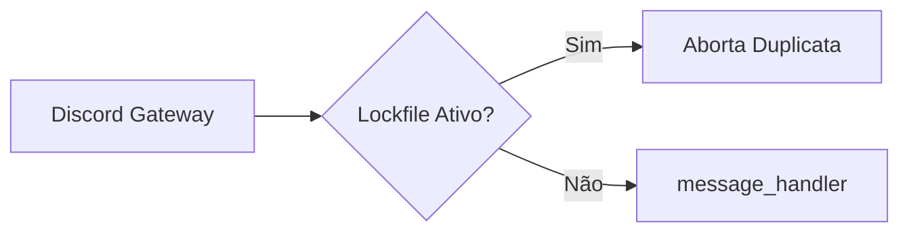
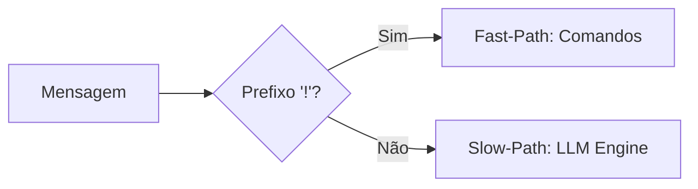
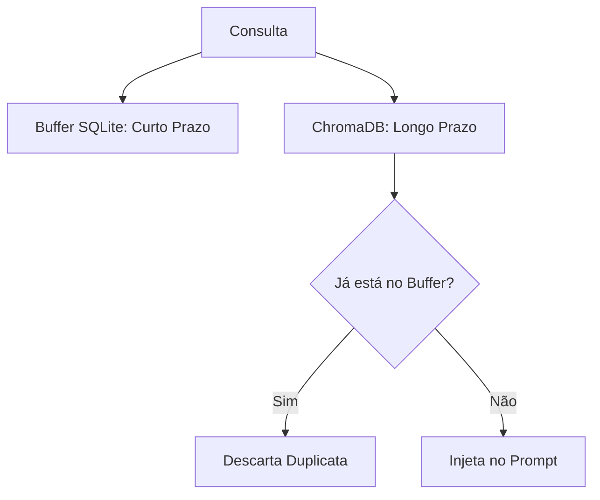
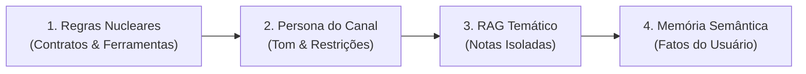
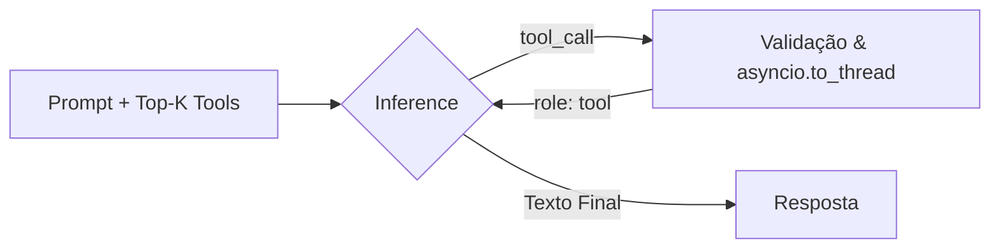
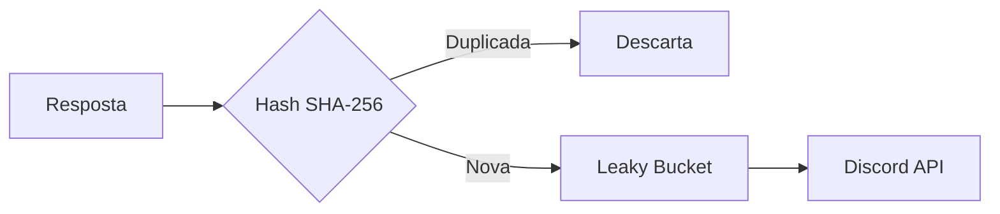
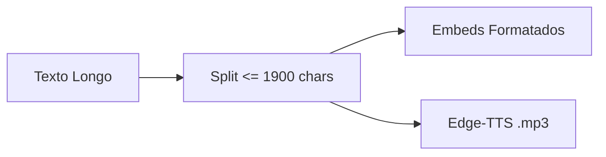

<!-- _transition: fade -->

# Arquitetura Orientada a Eventos & Engenharia de Prompt
Layout: [Destaque Numérico / Visão Geral Acadêmica]

Orquestração de **Modelos de Linguagem** em produção de alta concorrência:

- **8** Camadas Modulares com **Isolamento de Contexto**
- **4** Níveis de Injeção Hierárquica no **System Prompt**
- **80%** de Redução de Janela com **Dynamic Tool RAG**
- **41** Testes Automatizados passando em **0.31s**

<!--
🎯 Ponto Focal: Estabelecer a relevância do trabalho sob a ótica de Engenharia de Prompt aplicada e sistemas reais.
🗣️ Fala Sugerida (50s): "Professor, este trabalho aborda um dos maiores desafios de IA aplicada: como operar modelos de linguagem em produção sem estourar janelas de contexto, sem sofrer alucinações de schema e mantendo privacidade absoluta. Apresento a arquitetura do nosso assistente para Discord, estruturada em 8 camadas com separação cirúrgica entre automação determinística e raciocínio neural."
🔗 Gancho de Transição: "Vamos iniciar pela primeira fronteira do sistema: a camada de ingestão e controle de concorrência do Discord."
-->

---

<!-- _transition: slide -->

# Layer 1: Discord Client & Gateway
Layout: [Split 50/50: Texto + Diagrama]

Ingestão assíncrona orientada a eventos e proteção contra concorrência:

- **WebSocket Assíncrono:** Captura de eventos `on_message` em tempo real
- **Instância Única Atômica:** Lockfile `.bot.lock` contra processos zumbis
- **Zero Processamento no Loop:** Despacho imediato para workers dedicados

<!--
🎯 Ponto Focal: Demonstrar robustez de infraestrutura prevenindo que o modelo responda duas vezes à mesma mensagem.
🗣️ Fala Sugerida (45s): "A primeira camada conecta-se ao Gateway do Discord via WebSocket assíncrono. Implementamos uma trava atômica por arquivo de lock (.bot.lock) que impede que duas instâncias concorrentes subam simultaneamente. Isso elimina o risco de rajadas de eventos duplicados que sobrecarregariam desnecessariamente os pipelines de prompt."
🔗 Gancho de Transição: "Uma vez capturado o evento bruto, como pré-processamos entradas multimídia antes de passá-las ao modelo?"
-->

---

<!-- _transition: slide -->

# Layer 2: Ingestão Multimodal — Saneamento Pré-Prompt
Layout: [Antes vs Depois / Comparativo de Fricção]

**Abordagem Convencional Ingênua:**
- Envio de áudio cru ou texto integral de PDFs de 500 páginas
- **Explosão da janela de contexto** e alto custo de inferência

**Nossa Engenharia de Ingestão:**
- **Faster-Whisper (int8 CPU VAD):** Transcrição limpa sem ruído
- **PyMuPDF TOC:** Extração seletiva apenas da árvore de sumários

<!--
🎯 Ponto Focal: Evidenciar que uma boa engenharia de prompt começa pelo saneamento e curadoria da entrada multimodal.
🗣️ Fala Sugerida (50s): "Em vez de cometer o erro comum de jogar arquivos brutos de centenas de páginas ou áudios longos na janela do LLM, implementamos pré-processadores especializados. Áudios são transcritos localmente pelo Faster-Whisper com detecção de voz ativa. PDFs são catalogados apenas por sua estrutura TOC; o modelo só recebe os capítulos específicos quando requisitado."
🔗 Gancho de Transição: "Com a entrada normalizada em texto, passamos para a camada de roteamento e isolamento de sessão."
-->

---

<!-- _transition: zoom -->

# Layer 3: O Dilema Fast-Path vs Slow-Path
Layout: [Split 50/50: Texto + Diagrama]

O princípio da parcimônia na **Engenharia de Prompt**:

- **O Melhor Prompt:** Aquele que você **não precisa gastar**
- **Fast-Path (<50ms):** Comandos nativos (`!agenda`, `!nota`) sem LLM
- **Slow-Path:** Raciocínio neural apenas para consultas abertas

<!--
🎯 Ponto Focal: Enfatizar que a melhor prática de prompt engineering em larga escala é a triagem de intenções determinísticas.
🗣️ Fala Sugerida (50s): "Uma lição acadêmica fundamental: usar LLM para operações determinísticas, como ver a hora ou listar lembretes, é um anti-padrão que gera latência e custo desnecessários. O Fast-Path intercepta comandos com prefixo e os executa em menos de 50 milissegundos. O Slow-Path é reservado estritamente para quando há necessidade real de interpretação semântica."
🔗 Gancho de Transição: "E como garantimos que usuários em canais diferentes não misturem seus contextos no mesmo event loop?"
-->

---

<!-- _transition: slide -->

# Layer 3: Isolamento Assíncrono com ContextVars
Layout: [3 Colunas de Cards]

Eliminação de **Prompt Contamination** e vazamento concorrente:

**Isolamento por Corrotina**
- Cada task no event loop possui seu próprio contexto de execução
- Previne vazamento de identidade

**Rastreamento Seguro**
- `user_id`, `channel_id`, `guild_id`
- Anexos e views temporárias rastreados sem variáveis globais

**Blindagem Multi-Tenant**
- Usuários simultâneos operam com isolamento estrito
- Zero cross-talk entre sessões

<!--
🎯 Ponto Focal: Explicar a importância da thread-safety assíncrona para evitar que um prompt seja montado com dados de outro usuário.
🗣️ Fala Sugerida (45s): "Em Python assíncrono, variáveis globais causam race conditions onde dados de um usuário podem contaminar o prompt de outro. Utilizamos ContextVars no context_manager.py, garantindo que o contexto de cada corrotina seja estritamente isolado do início ao fim da requisição."
🔗 Gancho de Transição: "Com o isolamento garantido, como o sistema busca dados históricos relevantes sem saturar o contexto?"
-->

---

<!-- _transition: slide -->

# Layer 4: Memória Híbrida & Deduplicação RAG
Layout: [Split 50/50: Texto + Diagrama]

Estratificação de memória e filtragem anti-redundância:

- **Buffer Relacional (SQLite WAL):** Últimas mensagens imediatas
- **RAG de Longo Prazo (ChromaDB):** Fatos e preferências semânticas
- **Filtro Anti-Redundância:** Impede que memórias já presentes no buffer recente sejam reinjetadas no prompt

<!--
🎯 Ponto Focal: Destacar a inteligência algorítmica de deduplicação antes da injeção no prompt.
🗣️ Fala Sugerida (50s): "Muitos sistemas de RAG injetam no prompt trechos que o usuário acabou de falar, desperdiçando tokens. Nossa Layer 4 possui um filtro que compara o resultado da busca vetorial com o buffer recente do SQLite; se a informação já está visível no histórico imediato, ela é sumariamente descartada para poupar janela de contexto."
🔗 Gancho de Transição: "Chegamos agora ao coração da apresentação: a montagem matemática do System Prompt Único."
-->

---

<!-- _transition: zoom -->

# Layer 5: A Obra de Arte — Montagem do System Prompt
Layout: [Timeline Horizontal / Estratificação Hierárquica]

Construção determinística de **uma única mensagem de sistema**:

- **Injeção em Camadas:** Da regra mais imutável ao dado mais volátil
- **Cláusulas Anti-Quebra:** Proibição explícita de desvio de persona
- **Ancoragem Fática:** Instrução de fundamentação obrigatória nas notas

<!--
🎯 Ponto Focal: Detalhar a arquitetura da mensagem de sistema consolidada em índice 0.
🗣️ Fala Sugerida (55s): "Aqui está o núcleo da nossa engenharia de prompt. Em vez de espalhar instruções em várias mensagens, consolidamos quatro camadas hierárquicas em um único System Prompt: 1) Regras nucleares de segurança e ferramentas; 2) Persona do canal com regras estritas de tom; 3) Base de conhecimento temática do canal via RAG isolado; e 4) Memórias semânticas de longo prazo do usuário. Isso cria uma hierarquia de prioridades cristalina para o LLM."
🔗 Gancho de Transição: "Mas modelos locais possuem uma restrição técnica crucial quanto a templates de chat: como lidamos com Jinja?"
-->

---

<!-- _transition: slide -->

# Layer 5: Compatibilidade com Chat Templates Jinja
Layout: [Antes vs Depois / Engenharia Defensiva]

**A Fragilidade dos Templates Modernos (Llama 3 / Mistral):**
- Múltiplos blocos `role: system` causam exceção crítica:  
  *`"System message must be at the beginning of message list"`*

**Nossa Sanitização Defensiva (`sanitizar_mensagens_jinja`):**
- **Aglutinação:** Funde todas as seções de sistema com `\n\n` no **índice 0**
- **Sanitização de Badges:** Remove formatação de telemetria do histórico para impedir **alucinação de metadados**

<!--
🎯 Ponto Focal: Demonstrar o rigor de engenharia na adaptação do prompt aos templates de tokenização dos modelos abertos.
🗣️ Fala Sugerida (50s): "Modelos modernos abertos no LM Studio utilizam Jinja chat templates que quebram se houver mais de uma mensagem com papel de sistema. Nossa função sanitizar_mensagens_jinja normaliza a lista, fundindo todas as camadas no índice zero. Além disso, criamos um sanitizador que limpa badges do histórico recente, impedindo que o modelo comece a imitar metadados de sistema."
🔗 Gancho de Transição: "E como fornecemos dezenas de ferramentas para a IA sem sobrecarregar o prompt?"
-->

---

<!-- _transition: zoom -->

# Layer 5: Dynamic Tool RAG por Cosseno
Layout: [Destaque Numérico / Otimização de Tokens]

Mitigação de **Context Bloat** e prevenção de chamadas incorretas:

- **46 Ferramentas Catalogadas:** Injetar todas gastaria **~5.000 tokens**
- **Similaridade de Cosseno:** Vetorização da intenção do usuário vs ferramentas
- **Top-K Filtrado:** Injeta apenas as **3 a 5 ferramentas pertinentes**
- **Redução de 80%** no overhead de tokens e **zero confusão de schemas**

<!--
🎯 Ponto Focal: Explicar o Tool RAG como técnica avançada de redução de contexto e aumento de precisão em Function Calling.
🗣️ Fala Sugerida (55s): "Se enviássemos os schemas JSON das 46 ferramentas a cada turno, consumiríamos 5.000 tokens antes mesmo do usuário falar, gerando lentidão e alucinações de parâmetros. Criamos o Dynamic Tool RAG: calculamos a similaridade de cosseno entre o embedding da mensagem e as descrições das ferramentas, injetando apenas o Top-K mais provável. O modelo recebe apenas o que realmente precisa."
🔗 Gancho de Transição: "Uma vez selecionadas as ferramentas, como opera o ciclo de execução e failover híbrido?"
-->

---

<!-- _transition: slide -->

# Layer 5: Roteamento Híbrido & Function Calling Loop
Layout: [Split 50/50: Texto + Diagrama]

Alta disponibilidade com **Local-First** e tolerância a falhas:

- **Prioridade Local:** LM Studio primário para privacidade e custo zero
- **Failover Nuvem:** Transbordo transparente para Gemini API em caso de erro
- **Sanitização de Argumentos:** Validação rigorosa contra tipos alucinados

<!--
🎯 Ponto Focal: Descrever o ciclo recursivo de chamadas de ferramentas e a resiliência do roteamento híbrido.
🗣️ Fala Sugerida (50s): "O motor de inferência prioriza o LM Studio local. Caso ocorra timeout ou sobrecarga, há failover automático para a API do Gemini. Quando o modelo emite um tool_call, os argumentos são sanitizados antes da execução assíncrona. O retorno entra no contexto com role tool, permitindo que o modelo sintetize a resposta final fundamentada nos dados reais."
🔗 Gancho de Transição: "E a resposta não precisa ser apenas texto: ela se conecta a componentes visuais interativos."
-->

---

<!-- _transition: slide -->

# Layer 6: UI Engine — O Prompt que Cria Interface
Layout: [3 Colunas de Cards]

Transição do texto conversacional para **Affordances Visuais**:

**Views Dinâmicas**
- `discord.ui.View` com botões de ação e confirmação
- Redução de atrito de digitação

**Seletores de Conteúdo**
- Menus dropdown para capítulos de PDFs (`PDFChapterSelectView`)
- Navegação estruturada

**Modais & Formulários**
- Coleta de entradas complexas sem quebrar o fluxo conversacional
- Interatividade em tempo real

<!--
🎯 Ponto Focal: Mostrar que o resultado do prompt interage organicamente com elementos gráficos da plataforma.
🗣️ Fala Sugerida (45s): "Na Layer 6, o modelo não fica restrito a cuspir texto corrido. Quando o modelo agenda um lembrete ou sumariza um PDF, ele acopla botões de ação, menus dropdown de capítulos e formulários modais do discord.ui, enriquecendo a experiência do usuário."
🔗 Gancho de Transição: "Para enviar essas respostas com segurança e sem tomar ban da API, entra o Outbox Gateway."
-->

---

<!-- _transition: slide -->

# Layer 7: Outbox Gateway — Rate Limits & Anti-Spam
Layout: [Split 50/50: Texto + Diagrama]

Engenharia defensiva contra bloqueios da API do Discord:

- **Dual-Tier Outbox:** Fila rápida para chat e *Leaky Bucket* para background
- **Deduplicação SHA-256:** Janela deslizante que descarta mensagens repetidas
- **Circuit Breaker:** Proteção contra rajadas e loops infinitos

<!--
🎯 Ponto Focal: Explicar a importância da camada de saída para proteção de taxa de transferência (rate-limits).
🗣️ Fala Sugerida (45s): "A Layer 7 é o nosso barramento de saída. O Discord impõe limites estritos de requisições por segundo. Nosso Gateway utiliza o algoritmo Leaky Bucket e calcula o hash SHA-256 de cada mensagem; se um worker tentar emitir a mesma mensagem em uma janela curta, ela é descartada como duplicata, protegendo a conta do bot contra banimentos."
🔗 Gancho de Transição: "Por fim, a camada de entrega formata a mensagem e sintetiza áudio quando requerido."
-->

---

<!-- _transition: slide -->

# Layer 8: Entrega Multimodal & Chunking Semântico
Layout: [Split 50/50: Texto + Diagrama]

Finalização da esteira e conformidade com limites da plataforma:

- **Chunking Semântico:** Divisão estrita em blocos de até **1900 caracteres**
- **Quebra Inteligente:** Respeita quebras de linha e blocos de código
- **Voz Neural (Edge-TTS):** Conversão texto-para-áudio de alta fidelidade
- **Rich Embeds:** Destaque visual com cores semânticas e persona ativa

<!--
🎯 Ponto Focal: Concluir o ciclo demonstrando que a entrega respeita os limites físicos de caracteres e opções multimídia.
🗣️ Fala Sugerida (45s): "Na última camada, a resposta consolidada é particionada em blocos de até 1900 caracteres preservando a sintaxe markdown. Se o usuário estiver no modo de voz, o Edge-TTS sintetiza o áudio neuralmente em pt-BR e o envia junto com Rich Embeds coloridos contendo as fontes consultadas."
🔗 Gancho de Transição: "Como sustentamos e evoluímos esse sistema sem regressões? Através de governança multiagente."
-->

---

<!-- _transition: slide -->

# Governança do Ecossistema: 15 Agentes em Produção
Layout: [Grade 2x2 / Matriz de Engenharia]

Confiabilidade comprovada e controle contínuo de qualidade:

**Qualidade & Robustez**
- **41 testes automatizados** passando em **0.31s**
- Tipagem estática rigorosa (**100% PEP 484**)

**Soberania & Governança**
- **Arquiteto-Chefe Soberano:** Humano no controle total
- **15 Agentes Especializados:** Esteira de evolução contínua

<!--
🎯 Ponto Focal: Mostrar a solidez do código e a disciplina de testes assíncronos que sustentam os prompts.
🗣️ Fala Sugerida (45s): "Por trás desse bot opera um ecossistema de 15 agentes especializados em governança, arquitetura e auditoria. Toda funcionalidade possui cobertura de testes assíncronos e 100% de tipagem estática. A suíte inteira de 41 testes executa em apenas 0.3 segundos, garantindo regressão zero a cada evolução de prompt."
🔗 Gancho de Transição: "Vamos agora sintetizar as contribuições acadêmicas deste trabalho."
-->

---

<!-- _transition: fade -->

# Conclusão & Contribuições Acadêmicas de Prompt
Layout: [Grade 2x2 / Síntese Científica]

**Estratégias Chave de Engenharia de Prompt:**
- **Hierarquia Rígida:** System Prompt único em 4 camadas bem delimitadas
- **Curadoria Ativa (Tool RAG):** Redução drástica de ruído de tokens

**Arquitetura & Confiabilidade:**
- **Fast-Path Primeiro:** Economia de inferência onde o determinismo basta
- **Local-First Soberano:** Custo zero de inferência e total privacidade

<!--
🎯 Ponto Focal: Fechar a apresentação respondendo diretamente à avaliação acadêmica do professor.
🗣️ Fala Sugerida (50s): "Em resumo, professor, este trabalho demonstra que uma Engenharia de Prompt de nível de produção vai muito além de escrever boas frases: ela exige orquestração em camadas, deduplicação de memória, poda semântica de ferramentas e respeito aos chat templates de cada modelo. Com isso, entregamos um assistente veloz, resiliente e 100% privado. Muito obrigado e fico aberto a suas perguntas e comentários."
🔗 Gancho de Transição: "Espaço aberto para debate técnico e arguição acadêmica."
-->

