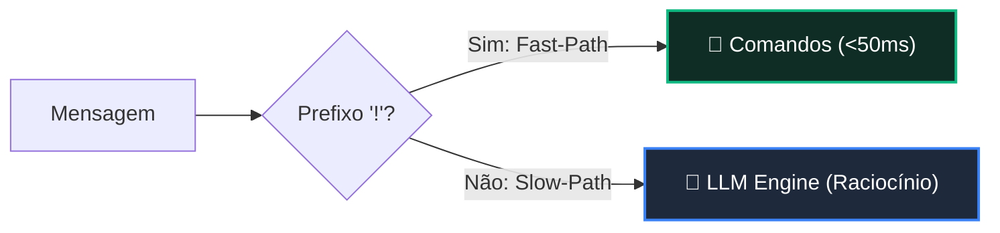
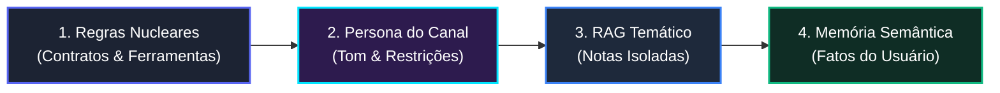

<!-- _transition: fade -->

# Roteamento de Intenções: Fast-Path vs Slow-Path
Layout: [Split 50/50: Parcimônia de Prompt]

O princípio da parcimônia na **Engenharia de Prompt**:

- **Triagem Imediata:** Comandos com prefixo (`!`) interceptados pelo `CommandRegistry`
- **Fast-Path (<50ms):** 34 comandos determinísticos executados sem invocar IA
- **Slow-Path Neural:** Acionado exclusivamente quando há necessidade de raciocínio
- **Impacto Prático:** Custo zero de tokens e latência mínima para tarefas rotineiras

<!--
🎯 Ponto Focal: Abertura Direta no Roteamento & Parcimônia [00:00 - 00:15]
🗣️ Fala Sugerida (15s): "Entrando agora no núcleo de roteamento e decisão cognitiva da arquitetura: nossa primeira regra de engenharia de prompt foi a parcimônia. Comandos determinísticos com prefixo entram no Fast-Path e respondem em menos de 50 milissegundos sem acionar LLM, reservando a inferência neural exclusivamente para consultas abertas."
🔗 Gancho de Transição: "E quando a IA precisa ser acionada, como estruturamos a mensagem de sistema?"
-->

---

<!-- _transition: slide -->

# Estratificação Hierárquica do System Prompt Único
Layout: [Timeline / Estratificação em 4 Camadas]

Construção determinística de **uma única mensagem de sistema** no índice 0:

- **Camadas Delimitadas:** Da regra nuclear inviolável às memórias de longo prazo
- **Sanitização Jinja:** Fusão mandatória no índice 0 para modelos abertos (Llama/Mistral)
- **Filtro Anti-Redundância:** Descarta do RAG fatos já presentes no buffer recente

<!--
🎯 Ponto Focal: Estrutura Interna do System Prompt [00:15 - 00:30]
🗣️ Fala Sugerida (15s): "Quando o Slow-Path é ativado, montamos um System Prompt único em quatro camadas hierárquicas — do núcleo inviolável e persona do canal até o RAG de notas e memórias de longo prazo. Tudo é consolidado no índice zero para compatibilidade estrita com chat templates Jinja de modelos locais."
🔗 Gancho de Transição: "Mas fornecer dezenas de ferramentas sem estourar o contexto exigiu outra inovação."
-->

---

<!-- _transition: zoom -->

# Dynamic Tool RAG por Similaridade de Cosseno
Layout: [Destaque Numérico / Otimização de Janela]

Mitigação de **Context Bloat** e eliminação de alucinações de schema:

- **O Gargalo dos 46 Schemas:** Injetar todas as ferramentas consumiria **~5.000 tokens**
- **Filtragem Vetorial:** Embedding da intenção comparado com a descrição das tools
- **Top-K Seletivo:** Injeção precisa de apenas **3 a 5 ferramentas** no turno atual
- **Resultado:** **Redução de 80% da janela** e chamadas de função com acurácia máxima

<!--
🎯 Ponto Focal: Dynamic Tool RAG como Solução de Engenharia [00:30 - 00:45]
🗣️ Fala Sugerida (15s): "Para viabilizar 46 ferramentas sem explodir a janela de contexto, implementamos o Dynamic Tool RAG: calculamos a similaridade de cosseno entre a intenção do usuário e as tools, injetando apenas o Top-K de três a cinco ferramentas. Isso poupa 80% dos tokens e praticamente aniquila alucinações de schema."
🔗 Gancho de Transição: "Para sustentar esse fluxo com segurança, a execução precisa ser blindada."
-->

---

<!-- _transition: fade -->

# Isolamento Concorrente & Ciclo de Execução
Layout: [3 Colunas de Cards / Robustez de Engenharia]

Garantia de **Thread-Safety** e proteção da esteira de saída:

**Isolamento ContextVars**
- Contexto isolado por corrotina
- **Zero contaminação cruzada** de prompts entre canais simultâneos

**Validação de Tool Calls**
- Sanitização dinâmica de argumentos
- Execução não-bloqueante via `asyncio.to_thread`

**Outbox Gateway Defensivo**
- Fila com *Leaky Bucket*
- Deduplicação SHA-256 e entrega sem rate-limits do Discord

<!--
🎯 Ponto Focal: Execução Segura e Passagem da Palavra [00:45 - 01:00]
🗣️ Fala Sugerida (15s): "Por fim, toda a execução é blindada por ContextVars para impedir contaminação cruzada de prompts entre canais concorrentes, enquanto o Outbox Gateway com Leaky Bucket garante despacho seguro e sem rate-limits. Com essa esteira cognitiva consolidada, passo a palavra para o próximo bloco da apresentação."
-->
