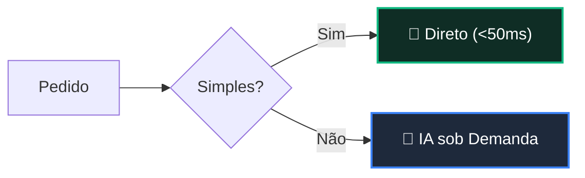

<!-- _transition: fade -->

# O Cérebro do Sistema: O Rápido vs O Inteligente
Layout: [Split 55/45: Animação Roteamento Fast vs Slow]

A regra de ouro: **não desperdiçar inteligência artificial**.

- **Resposta na Hora:** Pedidos simples respondem em milissegundos sem gastar IA
- **IA sob Demanda:** O modelo só pensa quando a pergunta exige raciocínio real
- **34 Comandos Diretos:** Agenda, anotações e lembretes funcionam instantaneamente
- **Economia Total:** Custo zero de tokens e máxima agilidade no dia a dia

<!--
🎯 Ponto Focal: Abertura Direta no Cérebro do Sistema [00:00 - 00:15]
🗣️ Fala Sugerida (15s): "Entrando agora no cérebro do sistema: nossa primeira regra foi não desperdiçar inteligência artificial. Se você pede algo simples, como a agenda ou uma anotação, o bot responde na hora, em milissegundos, sem gastar processamento de IA. A inteligência artificial só é ativada quando a pergunta realmente exige raciocínio."
🔗 Gancho de Transição: "E quando a IA precisa ser chamada, como organizamos as ordens para ela?"
-->

---

<!-- _transition: slide -->

# Instruções em 4 Camadas Organizadas
Layout: [Split 55/45: Animação Esteira de Montagem de Prompt]

Como preparamos a mente da IA para ela **nunca se perder nem inventar**:

- **1. Regras de Segurança:** Limites invioláveis e blindagem anti-injeção
- **2. Estilo do Canal:** Tom e personalidade ajustados dinamicamente
- **3. Dados Reais:** Notas e documentos verificados (**zero alucinações**)
- **4. Memória:** Histórico recente do usuário sem repetições
- **Ordem Rígida:** Da regra mais sagrada até o contexto imediato

<!--
🎯 Ponto Focal: Instruções Bem Estruturadas [00:15 - 00:30]
🗣️ Fala Sugerida (15s): "E quando a IA é chamada, ela não recebe uma ordem bagunçada. Nós organizamos as instruções em quatro partes bem arrumadas: primeiro as regras de segurança que ela nunca pode quebrar, depois o estilo e o tom do canal, em seguida as informações reais do assunto e, por fim, a memória da conversa. Isso impede que o modelo invente coisas."
🔗 Gancho de Transição: "Mas o bot tem dezenas de ferramentas. Como a IA escolhe sem se confundir?"
-->

---

<!-- _transition: zoom -->

# A Caixa de Ferramentas sob Medida
Layout: [Split 55/45: Animação Radar Semântico de Ferramentas]

Entregando para a IA apenas **o que ela realmente precisa usar**:

- **46 Ferramentas Disponíveis:** Leitura de PDFs, web, agenda e banco
- **O Problema:** Entregar a caixa inteira deixaria a IA **lenta e confusa**
- **O Filtro Inteligente:** Busca vetorial seleciona as **3 ou 4 ferramentas certas**
- **Resultado Prático:** **80% de economia** de processamento e precisão máxima

<!--
🎯 Ponto Focal: Seleção de Ferramentas sob Medida [00:30 - 00:45]
🗣️ Fala Sugerida (15s): "O assistente tem 46 ferramentas, como ler arquivos e pesquisar na internet. Mas se dermos a caixa inteira de uma vez, a IA fica lenta e confusa. Por isso, criamos um filtro que adivinha a necessidade do usuário e entrega apenas as três ou quatro ferramentas certas para aquele momento, economizando 80% de processamento."
🔗 Gancho de Transição: "E como mantemos tudo isso seguro enquanto várias pessoas conversam?"
-->

---

<!-- _transition: fade -->

# Privacidade Total e Respostas sem Travamento
Layout: [Split 55/45: Animação Isolamento e Fila Anti-Spam]

Blindagem técnica para uma experiência **fluida, privada e segura**:

- **Conversas Isoladas:** Contexto individual blindado (`ContextVars`)
- **Sem Vazamentos:** Pessoas simultâneas nunca misturam dados
- **Execução Desacoplada:** Tarefas pesadas em background sem congelar o bot
- **Fila Anti-Spam:** Buffer inteligente entrega mensagens sem cortes nem engasgos

<!--
🎯 Ponto Focal: Segurança e Passagem da Palavra [00:45 - 01:00]
🗣️ Fala Sugerida (15s): "Para fechar, garantimos que as conversas de pessoas diferentes nunca se misturem e que as mensagens saiam organizadas, sem travamentos no chat. Com essa estrutura de raciocínio rápida e segura, passo a palavra para o próximo bloco da nossa apresentação."
-->

